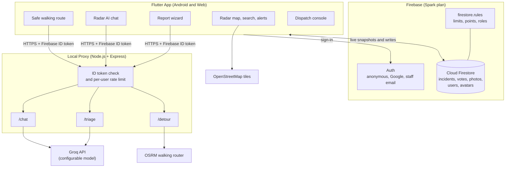

# HazardRadar AI

> **Crowdsourced, AI-triaged urban hazard radar for commuters in Mandaue City, Cebu**
> *See the risk before you walk into it.*

**Status:** in active testing (Mobile Programming I project). Not deployed yet; it runs locally.
Last updated 20 Nov 2026 at commit `ba93482`. When you change the app, update this file with the
[checklist at the end](#keeping-this-readme-up-to-date).


---

## Executive Summary

Urban commuters in Cebu meet the same hazards every day: deep potholes, exposed or sparking wires,
broken streetlights, flash flooding, and fallen obstructions. Reporting them is slow and scattered:

* **Fragmented reporting channels:** complaints end up in social media posts and hotline queues
  that city crews cannot sort or track.
* **Vague descriptions:** notes are emotional, incomplete, or in mixed languages, so triage takes time.
* **No live awareness:** commuters cannot see the risks on their route before they reach them.
* **No ground truth:** there is no simple way to check that a report is real, still there, or fixed.

**HazardRadar AI** puts a live, color-coded hazard map in every commuter's pocket. A report is a GPS
fix, a camera photo, and a short note in English, Tagalog, or Cebuano. An AI model turns the note into
a standard category, a risk level, and a one-line summary. Neighbors within 200 m confirm or dispute
it, and city staff work through a prioritized dispatch queue until the hazard is resolved. Everything
runs on free tiers: Firebase Spark, Groq, and OpenStreetMap.

---

## System Features

### Mobile and Web App (`lib/`, Flutter for Android and web)
* **Live Hazard Radar:** public Active and In-progress reports stream onto an OpenStreetMap map as
  round pins colored by risk (Low green, Medium amber, High red-orange, In progress blue). Nearby pins
  merge into square count blocks that zoom in when tapped. The camera stays inside the Philippines and
  falls back to Mandaue City when GPS is off. Map tiles are cached on the phone (up to 150 MB).
* **Search That Moves the Map:** search by HZD id, category, risk ("high risk"), status
  ("in progress"), "verified", or any word of the AI summary, in any case or word order. Filter chips
  show live counts. Both fly the camera to the matching pins.
* **Proximity and New-Report Alerts:** a banner warns about a High-risk hazard within 100 m of you
  (once per hazard per session) and about new High-risk reports while you watch the map.
* **Hazard Sheet:** a short summary that expands to the photo, reporter note and trust level,
  recommended action, distance, and the community vote tally.
* **Four-Step Report Wizard:** confirm the location (real GPS only; the pin can move up to 100 m),
  take a camera photo (no gallery; compressed to 150 KB or less), write a note, then review the AI result
  before publishing. If the AI is unreachable, an on-device keyword classifier answers, and the app
  sends the note to the AI again on a later launch.
* **Radar AI Assistant:** a chat grounded in the 20 hazards nearest the map center, with risk
  analysis, recommendations, a 3-question commuter interview, and safe-detour modes. Only incident id,
  category, risk, and summary are sent; reporter ids and notes stay on the phone. Map actions are
  accepted only for incidents the app sent.
* **Hazard-Avoiding Walking Route:** pick a destination within 10 km. The route keeps at least 40 m
  from High and Medium hazards when the streets allow it, detours around the hazard that blocks the
  way, and says plainly when no safer route exists.
* **Community Verification:** Google-linked users vote "Still here" or "Fixed or fake" within 200 m.
  +3 net votes mark a report verified; -3 hides it for moderator review. Neighborhood Sentinels can
  flag spam and duplicates.
* **Civic Trust Points and Levels:** 10 points per report and 10 more when the city resolves it.
  Levels unlock higher daily limits, heavier votes, and moderation tools.
* **Profiles:** after Google sign-in the app asks for your name. Your name and a square profile photo
  (or initials) show in the top bar and Settings, and you can change both.
* **Settings:** level details (points, progress, what your level can do), Light or Dark appearance
  (Light by default, saved on the device), and a data saver that loads photos only on tap.
* **Clear Feedback:** success messages are green with a check icon; errors and blocked actions are
  red-orange with a warning icon, in both light and dark mode.

### City Staff Console (Dispatch tab, in the same app)
* **Dispatch Queue (dispatchers and admins):** open tickets ordered High first and oldest first, with
  KPIs and risk filters. Start work with a crew, resolve with a note (credits the reporter), edit the
  crew, or override the AI rating. Status moves one way: Active, In progress, Resolved.
* **Quarantine Review (dispatchers and admins):** disputed and flagged reports, with restore, an
  admin-only permanent purge, and a photo storage meter against the free 1 GiB.
* **User Management (admins):** a list of names and roles. Each user's page shows stats and lets an
  admin change role and level, account status (Warned, Suspended until a date, Banned), and the
  emergency no-daily-limit switch. Admins cannot change their own account.
* **City Analytics (admins):** resolution rate, mean time to resolve, active counts by risk, category
  share, 1 km hotspot cells, and how many reports the AI classified.
* **Staff Sign-In:** city-issued email and password accounts, or Google accounts with a staff role.
  A Google admin can add a staff password so the email form also works with their Gmail.

### AI and Routing Proxy (`proxy/`, Node.js and Express)
* **Key Isolation:** the only component that holds the Groq API key. The app never sees it.
* **Per-User Authentication:** every request carries the user's Firebase ID token, verified against
  Google's public keys. Requests are rate-limited per user (30 per minute; 6 routes per minute).
* **Endpoints:** `/triage` (category, risk, summary, action in strict JSON), `/chat` (Radar AI), and
  `/detour` (OSRM walking routes, then the safest pick). `/health` answers without a token.
* **Privacy:** request bodies and headers are never logged; only method, path, status, and duration.

### Firebase Backend (`firestore.rules`)
* **Rules as the Referee:** the Spark plan has no Cloud Functions, so the security rules enforce daily
  limits, points, level-ups, one vote per person, staff actions, account status, and photo sizes. The
  app repeats some checks only to show clear messages early.
* **Anonymous-First Accounts:** every install starts as a guest. Linking Google keeps the guest's data.
* **Photos in Firestore:** report photos (150 KB or less) and profile photos (29 KB or less) are Base64
  JPEG documents, so no paid Storage bucket is needed.
* **Tested Rules:** 68 emulator tests check allowed and denied cases for the rules.

---

## System Architecture



---

## Quick Start Guide

Run every command from the project folder (the one with `pubspec.yaml`), in PowerShell. `adb` is in the
Android SDK's `platform-tools` folder; add it to `PATH` or type the full path to `adb.exe`.

### 1. Prerequisites
* Flutter 3.38 or newer (stable), with the Android SDK and Chrome
* Node.js 20 or newer (tested on 22) with npm
* Java 11 or newer (tested on 23), only for the Firestore rules tests
* A Firebase project of your own and a Groq API key
* An Android phone with USB debugging, or an emulator

### 2. Firebase Console
1. **Authentication > Sign-in method:** enable **Anonymous** and **Google**. Enable **Email/Password**
   only for email staff accounts or the "Set staff password" option.
2. **Project settings > Your apps > Android:** add your debug SHA-1 for Google sign-in. Get it with
   `cd android; .\gradlew signingReport`.
3. **Firestore Database > Rules:** paste the whole of `firestore.rules` and click **Publish**. Republish
   after every change to that file.
4. **Firestore Database > Indexes > Composite > Create index > Create structured index**, collection
   `incidents`, query scope **Collection**. Create both, then wait until they show **Enabled**:
   * `visibility` Ascending, `status` Ascending, `createdAt` Descending (Radar map)
   * `reporterUid` Ascending, `createdAt` Descending (My Reports)
5. **First admin:** sign in to the app once with Google. In **Firestore Database > Data > users**, open
   the document whose id matches your **User UID** (shown in **Authentication > Users**) and set
   `role` = `ADMIN` (string) and `tier` = `5` (number). See [`docs/STAFF_SETUP.md`](docs/STAFF_SETUP.md).

### 3. Proxy Setup
```powershell
Copy-Item .env.example .env      # then set GROQ_API_KEY and FIREBASE_PROJECT_ID in .env
cd proxy; npm install
npm start                        # health check: http://127.0.0.1:3000/health
```

### 4. App Setup
```powershell
Copy-Item dart_defines.example.json dart_defines.json   # then set PROXY_URL and GOOGLE_SERVER_CLIENT_ID
flutter pub get
```
`.env` and `dart_defines.json` are git-ignored. Never commit them.

### 5. Run
```powershell
# Android phone over USB (run adb reverse again whenever the phone reconnects)
adb reverse tcp:3000 tcp:3000
flutter run --dart-define-from-file=dart_defines.json

# Web, in a second terminal
flutter run -d chrome --dart-define-from-file=dart_defines.json
```
While running, press `r` to hot reload, `R` to hot restart (use it after bigger changes), and `q` to quit.
Changing `dart_defines.json` needs a full restart. Restart the proxy after proxy or `.env` changes.

---

## Testing

| What | Command | Result at `db7f817` |
| :--- | :--- | :--- |
| Static analysis | `flutter analyze` | 0 issues |
| Flutter unit and widget tests | `flutter test --no-pub` | 173 passing |
| Proxy tests | `cd proxy; npm test` | 44 passing |
| Firestore rules tests (emulator) | `cd rules-test; npm install; npm run emulator:test` | 68 passing |
| Web build | `flutter build web --dart-define-from-file=dart_defines.json` | builds |

* The rules tests run against a local emulator (port 8085, project `demo-hazardradar`) and never touch
  the real database.
* `osm-warn` lines in the Flutter output are a reminder about the public tile server, not failures.
* PowerShell may show exit code 1 when a tool writes to stderr, even on success. Read the last lines.
* Manual test path: [`docs/WALKTHROUGH.md`](docs/WALKTHROUGH.md).

---

## Documentation Hub

| Document | Description |
| :--- | :--- |
| [**Walkthrough**](docs/WALKTHROUGH.md) | Step-by-step manual test path through every screen (58 steps, light and dark mode). |
| [**Why It Works This Way**](docs/WALKTHROUGH_WHY.md) | The mechanism behind every screen, action, and message, a scenario table, known quirks, and the change log. |
| [**Staff Setup**](docs/STAFF_SETUP.md) | Creating staff accounts and assigning dispatcher and admin roles. |
| [`firestore.rules`](firestore.rules) | The security rules, with a comment above each rule explaining what it allows. |
| [`firestore.indexes.json`](firestore.indexes.json) | The composite indexes the app needs. |

---

## Repository Structure

```text
hazardradarai/
├── README.md                    <-- Project overview (this file)
├── lib/                         <-- Flutter app
│   ├── main.dart                <-- Wires every service into HomeServices
│   ├── config/                  <-- Build values (proxy URL, Google client id)
│   ├── geo/                     <-- Geohash, Philippine bounds, Philippine day (UTC+8)
│   ├── models/                  <-- Incident, UserProfile, Report, TriageResult, Chat
│   ├── services/                <-- Firebase, proxy, location, photo, and policy code behind interfaces
│   ├── theme/                   <-- Fixed colors, light/dark palette, themes
│   └── ui/                      <-- account, chat, common, dispatch, home, map, report, reports, settings, splash
├── test/                        <-- Flutter tests with fakes for every service
├── proxy/                       <-- Node.js + Express proxy (src/, test/)
├── rules-test/                  <-- Firestore rules tests on the emulator
├── docs/                        <-- Walkthrough, explanations, staff setup
├── firestore.rules              <-- Security rules (publish in the console)
├── firestore.indexes.json       <-- Required composite indexes
├── firebase.json                <-- Emulator settings
├── .env.example                 <-- Proxy settings template
├── dart_defines.example.json    <-- App build values template
├── android/  web/               <-- Platform projects (Android and web are the tested targets)
└── assets/                      <-- Fonts (DM Serif Display) and the splash image
```

---

## Configuration Reference

### App build values (`dart_defines.json`)
| Key | Purpose | Without it |
| :--- | :--- | :--- |
| `PROXY_URL` | Base URL of the proxy | Radar AI and Safe route are hidden; triage runs offline only |
| `GOOGLE_SERVER_CLIENT_ID` | Web OAuth client id used by Google sign-in on Android | Android reads it from `google-services.json` |

### Proxy settings (`.env` in the project folder)
| Key | Default | Purpose |
| :--- | :--- | :--- |
| `GROQ_API_KEY` | required | Groq API key |
| `FIREBASE_PROJECT_ID` | value in `.env.example` | Project whose ID tokens are accepted |
| `GROQ_MODEL` | built-in default | Groq model used for triage and chat |
| `GROQ_TIMEOUT_MS` | `8000` | Groq request timeout |
| `RATE_LIMIT_PER_MINUTE` | `30` | Requests per user per minute |
| `DETOUR_PER_MINUTE` | `6` | Route requests per user per minute |
| `OSRM_BASE_URL` | public FOSSGIS foot router | Walking router |
| `PORT` | `3000` | Proxy port |

---

## Data Model

| Path | Contents |
| :--- | :--- |
| `users/{uid}` | role, tier, account status, suspension end, limit override, daily counter, trust points, report totals, display name, focus badge |
| `avatars/{uid}` | profile photo (Base64 JPEG, 29 KB or less) |
| `incidents/{id}` | reporter, category, risk, AI summary and action, AI flag, note, coordinates, geohash, status, visibility, net votes, crew, resolution note, timestamps |
| `incidents/{id}/photo/main` | report photo (Base64 JPEG, 150 KB or less) |
| `incidents/{id}/votes/{uid}` | one vote per user (plus or minus 1 or 2) |

Categories: Pothole, Electrical, Flooding, Obstruction, Lighting, Other. Reports are shown with a short
reference such as `HZD-4F9A2C`.

---

## Levels, Limits, and Rules

| Level | Title | How you get it | Reports per day | Vote weight | Extras |
| :--- | :--- | :--- | :--- | :--- | :--- |
| 1 | Commuter Observer | Default (guest) | 3 | none | Browse, report, chat |
| 2 | Civic Scout | Google sign-in or 50 points | 10 | 1 | Voting within 200 m |
| 3 | Neighborhood Sentinel | 250 points and 85% of reports resolved | unlimited | 2 | Flag spam, focus badge |
| 4 | Municipal Dispatcher | Set by an admin | unlimited | 2 | Queue, quarantine |
| 5 | System Administrator | Set by an admin | unlimited | 2 | Users, analytics, purge |

* The day resets at midnight Philippine time (UTC+8). Admins can switch off a user's daily limit.
* One vote per user per report, never on your own report.
* Warned users see a banner but can still act. Suspended and banned users cannot report or vote.
* Reports need a real GPS fix inside the Philippines; the fallback map center is never used.

---

## Design System

A flat poster look: square corners, no gradients, shadows, elevation, or glow. Map pins are the only
round shapes. Headings use DM Serif Display.

| Token | Light | Dark | Use |
| :--- | :--- | :--- | :--- |
| Background | Cream `#EFE6D5` | `#1C1B19` | Screens, sheets, dialogs |
| Text | Ink `#1B1B1B` | Cream `#EFE6D5` | Text, lines, icons |
| Panel | Sage `#9DBEB7` | `#35504A` | Panels, chips, indicators |
| Primary / High / Error | Red-orange `#E73213`, black text | same | Buttons, High risk, errors |
| Medium | `#C77700` | same | Medium risk |
| Low | `#2F7A56` | same | Low risk |
| In progress | `#2E4A62`, cream text | same | Tickets a crew is working on |
| Success | `#256446`, cream text | same | Success messages |

In code, use `context.palette` for colors that change with the mode and `AppColors` for fixed colors.

---

## Troubleshooting

| Symptom | Likely cause | Fix |
| :--- | :--- | :--- |
| Red "Could not load hazards" with `failed-precondition` | Missing composite index | Create both indexes (Quick Start step 2.4) |
| Phone shows only your own reports, web shows everyone's | Same missing index (the phone shows its cache) | Same as above |
| "The report was refused…" | Rules not published, daily limit reached, or account restricted | Publish `firestore.rules`; check the profile |
| Phone only: "route service is not reachable" or "Radar AI is not reachable" | The `adb reverse` link dropped | Run `adb reverse tcp:3000 tcp:3000` again |
| Phone and web can't reach Radar AI | Proxy stopped or its key is wrong | Start the proxy; check `/health` and the proxy log |
| Radar AI and Safe route buttons missing | No valid `PROXY_URL` | Fix `dart_defines.json`, then a full restart |
| "Could not save the photo" | Rules with `avatars/{uid}` not published | Republish `firestore.rules` |
| Staff email form rejects your Gmail | Google accounts have no password | Settings > City staff > Set staff password |
| No Dispatch tab for an admin | `role` is not exactly `ADMIN`, or a different account | Fix the profile document, then switch tabs |
| Old buttons or texts still show | The app runs the old code | Press `R`, or `q` and `flutter run` again |
| Editor shows errors in `lib/main.dart`, `flutter analyze` is clean | Stale editor tab | Ctrl+Shift+P > Revert File (don't save), then Dart: Restart Analysis Server |

More cases, with the reason behind each: [`docs/WALKTHROUGH_WHY.md`](docs/WALKTHROUGH_WHY.md).

---

## Known Limitations

* **Development-only services:** the public OpenStreetMap tile server and the public OSRM router are
  for demos. A release needs hosted tile and routing providers.
* **Local proxy:** phones reach it over USB. A release needs it deployed behind HTTPS.
* **Loaded pins only:** search and filters cover the newest 150 public open reports.
* **Analytics sample:** computed from the newest 500 reports.
* **Shared storage:** all data, photos included, shares Firestore's free 1 GiB.
* **Map in dark mode:** the tiles stay light; only the panels change.
* **Names:** users without a saved name show as "Name not set yet" to admins until they open the app.
* **Open design questions:**
  * The Quarantine button says "Restore and verify" but resets votes to 0.
  * Staff vote with weight 2 and see the focus badge picker.
* **Package id:** Android still uses `com.example.hazardradarai`.

---

## Security Notes

* Secrets live only in `.env` (proxy) and `dart_defines.json` (app build values), and both are
  git-ignored. Before each commit, scan the staged diff for key patterns:
  `git diff --cached | Select-String -Pattern 'AIza|gsk_[A-Za-z0-9]{20,}|PRIVATE KEY' -CaseSensitive:$false`
* `google-services.json` and `lib/firebase_options.dart` hold public Firebase identifiers and are
  tracked on purpose. Protection comes from the security rules. You can also restrict the Android API
  key to the app's package name and signing certificate.
* The proxy accepts only valid Firebase ID tokens, limits each user's request rate, caps body size at
  16 KB, and never logs bodies or headers.
* The app shows names and emails, never raw user ids.
* Never paste keys or tokens into screenshots, documents, or chat logs.

---

## Project Information

* **Course:** Mobile Programming I, built as a working prototype for Mandaue City, Cebu.
* **Branch:** day-to-day work happens on `development`, one commit per task.
* **Deployment:** not deployed yet. The app, the proxy, and the tests all run locally.
* **Project documentation:** the full course write-up (purpose, objectives, scope, and screens) is kept
  outside this code folder, together with the UI/UX mockups.

---

## Keeping This README Up to Date

When you change the app, check these sections:

- [ ] **Status line** at the top: date and latest commit (`git log --oneline -1`).
- [ ] **System Features** for any new, removed, or renamed screen or button.
- [ ] **Data Model** and **Levels, Limits, and Rules** if `firestore.rules`, limits, or fields
      changed. Republish the rules in the console.
- [ ] **Configuration Reference** if a build value or `.env` key was added.
- [ ] **Testing** results after running the commands.
- [ ] **Troubleshooting** for any new problem you hit and solved.
- [ ] **Known Limitations** when one is fixed or a new one appears.
- [ ] The files in `docs/`, if a screen or message changed.
