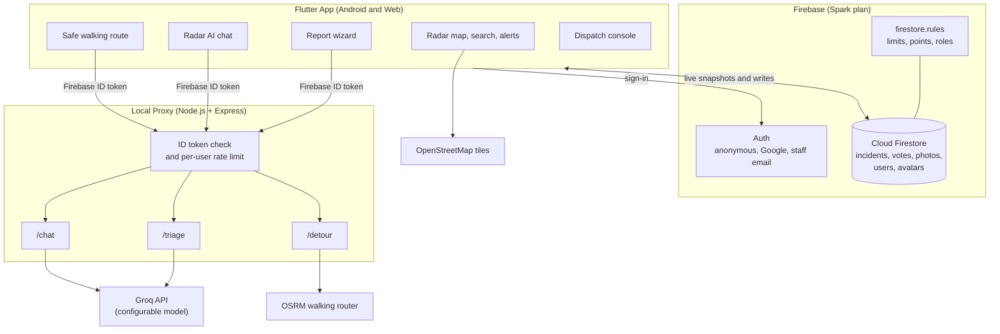

# HazardRadar AI

> **Crowdsourced, AI-triaged urban hazard radar for commuters in Mandaue City, Cebu**
> *See the risk before you walk into it.*

**Status:** in active testing (Mobile Programming I project). Not deployed yet; it runs locally.
Last updated 20 Nov 2026; describes the app at commit `db7f817`. When you change the app, update this file with the
[checklist at the end](#18-keeping-this-readme-up-to-date).


---

## Contents
1. [Executive Summary](#1-executive-summary)
2. [System Features](#2-system-features)
3. [System Architecture](#3-system-architecture)
4. [Tech stack](#4-tech-stack)
5. [Project layout](#5-project-layout)
6. [Requirements](#6-requirements)
7. [First-time setup](#7-first-time-setup)
8. [Running the app](#8-running-the-app)
9. [Testing](#9-testing)
10. [Configuration reference](#10-configuration-reference)
11. [Data model](#11-data-model)
12. [Levels, limits, and rules](#12-levels-limits-and-rules)
13. [Design system](#13-design-system)
14. [Troubleshooting](#14-troubleshooting)
15. [Known limitations](#15-known-limitations)
16. [Security notes](#16-security-notes)
17. [Other documentation](#17-other-documentation)
18. [Keeping this README up to date](#18-keeping-this-readme-up-to-date)

---

## 1. Executive Summary

Urban commuters in Cebu meet the same hazards every day: deep potholes, exposed or sparking wires,
broken streetlights, flash flooding, and fallen obstructions. Reporting them is slow and scattered:

* **Fragmented reporting channels:** complaints end up in social media posts and hotline queues
  that city crews cannot sort or track.
* **Vague descriptions:** notes are emotional, incomplete, or in mixed languages, so triage takes time.
* **No live awareness:** commuters cannot see the risks on their route before they reach them.
* **No ground truth:** there is no simple way to check that a report is real, still there, or fixed.

**HazardRadar AI** puts a live, color-coded hazard map in every commuter's pocket. A report is a GPS
fix, a camera photo, and a short note in English, Tagalog, or Cebuano. An AI model turns the note into
a standard category, a risk level, and a one-line summary. Neighbors within 200 m confirm or dispute
it, and city staff work through a prioritized dispatch queue until the hazard is resolved. Everything
runs on free tiers: Firebase Spark, Groq, and OpenStreetMap.

---

## 2. System Features

### Mobile and Web App (`lib/`, Flutter for Android and web)
* **Live Hazard Radar:** public Active and In-progress reports stream onto an OpenStreetMap map as
  round pins colored by risk (Low green, Medium amber, High red-orange, In progress blue). Nearby pins
  merge into square count blocks that zoom in when tapped. The camera stays inside the Philippines and
  falls back to Mandaue City when GPS is off. Map tiles are cached on the phone (up to 150 MB).
* **Search That Moves the Map:** search by HZD id, category, risk ("high risk"), status
  ("in progress"), "verified", or any word of the AI summary, in any case or word order. Filter chips
  show live counts. Both fly the camera to the matching pins.
* **Proximity and New-Report Alerts:** a banner warns about a High-risk hazard within 100 m of you
  (once per hazard per session) and about new High-risk reports while you watch the map.
* **Hazard Sheet:** a short summary that expands to the photo, reporter note and trust level,
  recommended action, distance, and the community vote tally.
* **Four-Step Report Wizard:** confirm the location (real GPS only; the pin can move up to 100 m),
  take a camera photo (no gallery; compressed to 150 KB or less), write a note, then review the AI result
  before publishing. If the AI is unreachable, an on-device keyword classifier answers, and the app
  sends the note to the AI again on a later launch.
* **Radar AI Assistant:** a chat grounded in the 20 hazards nearest the map center, with risk
  analysis, recommendations, a 3-question commuter interview, and safe-detour modes. Only incident id,
  category, risk, and summary are sent; reporter ids and notes stay on the phone. Map actions are
  accepted only for incidents the app sent.
* **Hazard-Avoiding Walking Route:** pick a destination within 10 km. The route keeps at least 40 m
  from High and Medium hazards when the streets allow it, detours around the hazard that blocks the
  way, and says plainly when no safer route exists.
* **Community Verification:** Google-linked users vote "Still here" or "Fixed or fake" within 200 m.
  +3 net votes mark a report verified; -3 hides it for moderator review. Neighborhood Sentinels can
  flag spam and duplicates.
* **Civic Trust Points and Levels:** 10 points per report and 10 more when the city resolves it.
  Levels unlock higher daily limits, heavier votes, and moderation tools.
* **Profiles:** after Google sign-in the app asks for your name. Your name and a square profile photo
  (or initials) show in the top bar and Settings, and you can change both.
* **Settings:** level details (points, progress, what your level can do), Light or Dark appearance
  (Light by default, saved on the device), and a data saver that loads photos only on tap.
* **Clear Feedback:** success messages are green with a check icon; errors and blocked actions are
  red-orange with a warning icon, in both light and dark mode.

### City Staff Console (Dispatch tab, in the same app)
* **Dispatch Queue (dispatchers and admins):** open tickets ordered High first and oldest first, with
  KPIs and risk filters. Start work with a crew, resolve with a note (credits the reporter), edit the
  crew, or override the AI rating. Status moves one way: Active, In progress, Resolved.
* **Quarantine Review (dispatchers and admins):** disputed and flagged reports, with restore, an
  admin-only permanent purge, and a photo storage meter against the free 1 GiB.
* **User Management (admins):** a list of names and roles. Each user's page shows stats and lets an
  admin change role and level, account status (Warned, Suspended until a date, Banned), and the
  emergency no-daily-limit switch. Admins cannot change their own account.
* **City Analytics (admins):** resolution rate, mean time to resolve, active counts by risk, category
  share, 1 km hotspot cells, and how many reports the AI classified.
* **Staff Sign-In:** city-issued email and password accounts, or Google accounts with a staff role.
  A Google admin can add a staff password so the email form also works with their Gmail.

### AI and Routing Proxy (`proxy/`, Node.js and Express)
* **Key Isolation:** the only component that holds the Groq API key. The app never sees it.
* **Per-User Authentication:** every request carries the user's Firebase ID token, verified against
  Google's public keys. Requests are rate-limited per user (30 per minute; 6 routes per minute).
* **Endpoints:** `/triage` (category, risk, summary, action in strict JSON), `/chat` (Radar AI), and
  `/detour` (OSRM walking routes, then the safest pick). `/health` answers without a token.
* **Privacy:** request bodies and headers are never logged; only method, path, status, and duration.

### Firebase Backend (`firestore.rules`)
* **Rules as the Referee:** the Spark plan has no Cloud Functions, so the security rules enforce daily
  limits, points, level-ups, one vote per person, staff actions, account status, and photo sizes. The
  app repeats some checks only to show clear messages early.
* **Anonymous-First Accounts:** every install starts as a guest. Linking Google keeps the guest's data.
* **Photos in Firestore:** report photos (150 KB or less) and profile photos (29 KB or less) are Base64
  JPEG documents, so no paid Storage bucket is needed.
* **Tested Rules:** 68 emulator tests check allowed and denied cases for the rules.

---

## 3. System Architecture



---

## 4. Tech stack

| Part | Technology |
|---|---|
| App | Flutter 3.38 (Dart 3.10), Material 3 with a custom flat theme |
| Map | `flutter_map` with OpenStreetMap tiles, `latlong2`, `geolocator` |
| Auth | `firebase_auth`, `google_sign_in` |
| Database | `cloud_firestore` |
| Photos | `image_picker`, `flutter_image_compress` |
| Settings | `shared_preferences` |
| Proxy | Node.js 22, Express 5, `jose` (ID token checks), `dotenv` |
| AI | Groq API (default model `openai/gpt-oss-120b`) |
| Routing | OSRM foot profile (public FOSSGIS server by default) |
| Rules tests | `@firebase/rules-unit-testing` with the Firestore emulator (Java needed) |

---

## 5. Project layout

```
hazardradarai/
  lib/
    main.dart                 Wires every service into HomeServices and starts the app
    config/                   Dart-define values (proxy URL, Google client id)
    geo/                      Geohash, Philippine bounds, Philippine day (UTC+8)
    models/                   Incident, UserProfile, Report, TriageResult, Chat, HazardCategory
    services/                 Firebase, proxy, location, photo, avatar, and policy code behind interfaces
    theme/app_theme.dart      Fixed colors (AppColors), light/dark palette (AppPalette), themes
    ui/
      account/                Account sheet (Google upgrade, Level details), name and photo dialogs
      chat/                   Radar AI sheet and controller
      common/                 Feedback messages, avatar, pull-to-refresh, status badges
      dispatch/               Queue, quarantine, users, user page, analytics
      home/                   HomeScreen (tabs, top bar, profile handling)
      map/                    Radar map, overlays, clusters, hazard sheet, alerts
      report/wizard/          The 4-step report wizard
      reports/                My Reports
      settings/               Settings and the City staff section
      splash/                 Launch screen
  test/                       Flutter unit and widget tests (fakes for every service)
  proxy/                      Express proxy: src/ (app, triage, chat, detour, idToken, rateLimit), test/
  rules-test/                 Firestore rules tests against the emulator
  firestore.rules             Security rules (publish in the Firebase console)
  firestore.indexes.json      The composite indexes the app needs (record only; create in the console)
  firebase.json               Emulator settings for the rules tests
  docs/                       Walkthrough, explanations, staff setup
  .env.example                Proxy settings template (copy to .env)
  dart_defines.example.json   App build values template (copy to dart_defines.json)
```

---

## 6. Requirements

- Flutter 3.38 or newer (stable channel), with Android SDK and Chrome for web.
- Node.js 20 or newer (tested on 22) for the proxy and the rules tests.
- Java 11 or newer (tested on 23) for the Firestore emulator in `rules-test`.
- A Firebase project of your own. Set `FIREBASE_PROJECT_ID` in `.env` to its project id.
- A Groq API key.
- An Android phone with USB debugging, or an emulator.

---

## 7. First-time setup

Run every command from the project folder (the one with `pubspec.yaml`), in PowerShell. `adb` is in
your Android SDK's `platform-tools` folder. Add that folder to `PATH`, or type the full path to `adb.exe`.

### 7.1 Firebase console
1. **Authentication > Sign-in method:** enable **Anonymous** and **Google**. Enable **Email/Password**
   only if you want email staff accounts or the "Set staff password" option.
2. **Android Google sign-in:** add your debug SHA-1 to the Android app in **Project settings**. Get it
   with `cd android; .\gradlew signingReport`.
3. **Firestore Database:** create the database, then open **Rules**, paste the whole of
   `firestore.rules`, and click **Publish**. Republish after every change to that file.
4. **Firestore Database > Indexes > Composite > Create index > Create structured index**, collection
   `incidents`, query scope **Collection**. Create both:
   - `visibility` Ascending, `status` Ascending, `createdAt` Descending (the Radar map)
   - `reporterUid` Ascending, `createdAt` Descending (My Reports)

   Wait until both show **Enabled**. They are also written in `firestore.indexes.json`.
5. **First admin:** sign in to the app once with Google, then in **Firestore Database > Data > users**
   open the document whose id is your **User UID** (from **Authentication > Users**) and set
   `role` = `ADMIN` (string) and `tier` = `5` (number). After that, admins manage roles in the app.
   Details: [`docs/STAFF_SETUP.md`](docs/STAFF_SETUP.md).

### 7.2 Proxy
1. `Copy-Item .env.example .env`
2. Open `.env` and set `GROQ_API_KEY` and `FIREBASE_PROJECT_ID` (your Firebase project id).
3. `cd proxy; npm install`

### 7.3 App build values
1. `Copy-Item dart_defines.example.json dart_defines.json`
2. Set `PROXY_URL` (`http://127.0.0.1:3000/` works for web and for a USB phone with `adb reverse`).
   Set `GOOGLE_SERVER_CLIENT_ID` to the **Web client** OAuth id from the Firebase / Google Cloud console.
3. `flutter pub get`

`.env` and `dart_defines.json` are git-ignored. Never commit them.

---

## 8. Running the app

Use separate terminals.

1. **Proxy:** `cd proxy; npm start`
   - Check it: open `http://127.0.0.1:3000/health`, which should answer `{"status":"ok"}`.
2. **Phone over USB:**
   - `adb reverse tcp:3000 tcp:3000`
   - `flutter run --dart-define-from-file=dart_defines.json`
3. **Web:** `flutter run -d chrome --dart-define-from-file=dart_defines.json`

While running:
- `r` hot reload, `R` hot restart (use `R` after bigger changes), `q` quit.
- Changing `dart_defines.json` needs a full restart (`q`, then `flutter run` again).
- Restart the proxy (`Ctrl+C`, `npm start`) after proxy changes or `.env` changes.
- Run `adb reverse` again whenever the phone reconnects. `adb reverse --list` must show `tcp:3000 tcp:3000`.

Build a web release with `flutter build web --dart-define-from-file=dart_defines.json` (output in `build/web`).

---

## 9. Testing

| What | Command | Count at `db7f817` |
|---|---|---|
| Static analysis | `flutter analyze` | 0 issues |
| Flutter tests | `flutter test --no-pub` | 173 |
| Proxy tests | `cd proxy; npm test` | 44 |
| Firestore rules tests | `cd rules-test; npm install; npm run emulator:test` | 68 |

- The rules tests start a local Firestore emulator on port 8085 (project `demo-hazardradar`) and never
  touch the real database.
- Lines mentioning `osm-warn` in the Flutter test output are a reminder from the map library about the
  public tile server, not failures.
- PowerShell may show exit code 1 when Flutter writes to stderr, even when everything passed. Read the
  last lines ("All tests passed!", "No issues found!").

Manual test path: [`docs/WALKTHROUGH.md`](docs/WALKTHROUGH.md).

---

## 10. Configuration reference

### App (`dart_defines.json`, passed with `--dart-define-from-file`)
| Key | Purpose | Without it |
|---|---|---|
| `PROXY_URL` | Base URL of the proxy | Ask Radar AI and Safe route are hidden; triage is offline only |
| `GOOGLE_SERVER_CLIENT_ID` | Web OAuth client id for Google sign-in on Android | Android reads it from `google-services.json` |

### Proxy (`.env` in the repo root)
| Key | Default | Purpose |
|---|---|---|
| `GROQ_API_KEY` | (required) | Groq API key |
| `FIREBASE_PROJECT_ID` | value in `.env.example` | Project whose ID tokens are accepted |
| `GROQ_MODEL` | `openai/gpt-oss-120b` | Groq model |
| `GROQ_TIMEOUT_MS` | `8000` | Groq request timeout |
| `RATE_LIMIT_PER_MINUTE` | `30` | Requests per user per minute |
| `DETOUR_PER_MINUTE` | `6` | Route requests per user per minute |
| `OSRM_BASE_URL` | `https://routing.openstreetmap.de/routed-foot` | Walking router |
| `PORT` | `3000` | Proxy port |

---

## 11. Data model

| Path | Contents |
|---|---|
| `users/{uid}` | `role` (CITIZEN, VERIFIER, DISPATCHER, ADMIN), `tier` (1 to 5), `accountStatus`, `suspendedUntil`, `rateLimitOverride`, `reportDay`, `reportCount`, `ctp` (trust points), `reportsTotal`, `reportsResolved`, `displayName`, `focusBadge` |
| `avatars/{uid}` | `imageBase64` (29 KB JPEG or less), `updatedAt` |
| `incidents/{id}` | `reporterUid`, `reporterTier`, `category`, `riskLevel`, `aiSummary`, `recommendedAction`, `aiProcessed`, `note`, `latitude`, `longitude`, `geohash`, `photoBytes`, `status` (ACTIVE, IN_PROGRESS, RESOLVED), `visibility` (PUBLIC, QUARANTINED), `netVotes`, `assignedCrew`, `resolutionNote`, timestamps |
| `incidents/{id}/photo/main` | `imageBase64` (150 KB JPEG or less), `mimeType`, `reporterUid` |
| `incidents/{id}/votes/{uid}` | `value` (plus or minus 1 or 2), `createdAt` |

Categories: Pothole, Electrical, Flooding, Obstruction, Lighting, Other. Reports are shown with a short
reference such as `HZD-4F9A2C` (the first 6 characters of the document id).

---

## 12. Levels, limits, and rules

| Level | Title | How you get it | Reports per day | Vote weight | Extras |
|---|---|---|---|---|---|
| 1 | Commuter Observer | Default (guest) | 3 | none | Browse, report, chat |
| 2 | Civic Scout | Google sign-in or 50 points | 10 | 1 | Voting within 200 m |
| 3 | Neighborhood Sentinel | 250 points and 85% of reports resolved | unlimited | 2 | Flag spam, focus badge |
| 4 | Municipal Dispatcher | Set by an admin | unlimited | 2 | Queue, quarantine |
| 5 | System Administrator | Set by an admin | unlimited | 2 | Users, analytics, purge |

- **Points:** +10 for each published report, +10 when staff resolve it.
- **Day boundary:** midnight in the Philippines (UTC+8). Admins can switch off a user's daily limit.
- **Votes:** one per user per report, not on your own report. +3 net marks it verified, -3 net moves it
  to quarantine.
- **Account status:** Warned users see a banner but can still act. Suspended (until a date) and Banned
  users cannot report or vote.
- **Location:** reports need a real GPS fix inside the Philippines (latitude 4.5 to 21.3, longitude
  116.7 to 127.0). The fallback map center is never used for a report.

---

## 13. Design system

A flat poster look: square corners, no gradients, shadows, elevation, or glow. Map pins are the only
round shapes. Headings use DM Serif Display.

| Token | Light | Dark | Use |
|---|---|---|---|
| Background (`paper`) | Cream `#EFE6D5` | `#1C1B19` | Screens, sheets, dialogs |
| Text (`ink`) | Ink `#1B1B1B` | Cream `#EFE6D5` | Text, lines, icons |
| Panel (`sage`) | Sage `#9DBEB7` | `#35504A` | Panels, chips, indicators |
| Primary / High | Red-orange `#E73213` with black text | same | Buttons, High risk, errors |
| Medium | `#C77700` | same | Medium risk |
| Low | `#2F7A56` | same | Low risk |
| In progress | `#2E4A62` with cream text | same | Tickets a crew is working on |
| Success | `#256446` with cream text | same | Success messages |

Use `context.palette` for colors that change with the mode, and `AppColors` for fixed colors.
The map tiles keep a cream tint at 55% color in both modes.

---

## 14. Troubleshooting

| Symptom | Likely cause | Fix |
|---|---|---|
| Red "Could not load hazards" with `failed-precondition` | Missing composite index | Create the indexes in [7.1](#71-firebase-console) step 4 |
| Phone shows only your own reports, web shows everyone's | Same missing index (the phone shows its local cache) | Same as above |
| "The report was refused…" | Rules not published, daily limit reached, or account restricted | Publish `firestore.rules`; check the profile in the console |
| Phone: "route service is not reachable" or "Radar AI is not reachable", web works | `adb reverse` link dropped | Run `adb reverse tcp:3000 tcp:3000` again |
| Both phone and web can't reach Radar AI | Proxy not running, or bad `GROQ_API_KEY` | `npm start` in `proxy/`; check `/health` and the proxy log |
| Ask Radar AI and Safe route buttons missing | No valid `PROXY_URL` | Fix `dart_defines.json`, then a full restart |
| "Could not save the photo" | Rules with `avatars/{uid}` not published | Republish `firestore.rules` |
| Staff email form rejects your Gmail | Google accounts have no password | Settings > City staff > Set staff password (needs Email/Password enabled) |
| No Dispatch tab for an admin | `role` isn't exactly `ADMIN`, or you are on a different account | Fix the profile document, then switch tabs to reload |
| Old buttons or texts still show | App still running the old code | Press `R` (hot restart), or `q` and `flutter run` again |
| VS Code shows errors in `lib/main.dart` but `flutter analyze` is clean | Stale editor tab | Ctrl+Shift+P > Revert File (don't save), then Dart: Restart Analysis Server |

More cases, with the reason behind each: [`docs/WALKTHROUGH_WHY.md`](docs/WALKTHROUGH_WHY.md), sections 13 to 15.

---

## 15. Known limitations

- **Development-only services.** The public OpenStreetMap tile server and the public OSRM router are
  for demos. A release needs a hosted tile provider and routing service.
- **The proxy runs on your PC.** Phones reach it over USB (`adb reverse`). A release needs the proxy
  deployed with HTTPS and `PROXY_URL` pointing to it.
- **Search and filters cover only loaded pins** (the newest 150 public open reports).
- **Analytics uses the newest 500 reports.**
- **Storage:** everything, including photos, shares the free 1 GiB of Firestore storage. The
  Quarantine and Analytics screens show an estimate.
- **The map stays light in dark mode.** Only the panels around it change.
- **Users without a saved name** show as "Name not set yet" to admins until they open the app and save one.
- **Open design questions:**
  - The Quarantine button says "Restore and verify" but resets votes to 0.
  - Staff vote with weight 2 and see the focus badge picker.
- **Android package id** is still `com.example.hazardradarai`.

---

## 16. Security notes

- Never commit `.env` or `dart_defines.json`. Before committing, scan the staged diff:
  `git diff --cached | Select-String -Pattern 'AIza|gsk_[A-Za-z0-9]{20,}|PRIVATE KEY' -CaseSensitive:$false`
- `google-services.json` and `lib/firebase_options.dart` contain public Firebase identifiers and are
  tracked on purpose. Protect the project with the rules and, optionally, by restricting the Android
  API key to the app's package name and SHA-1.
- Every proxy request needs a valid Firebase ID token and is rate-limited per user. Request bodies and
  headers are never logged.
- The chat sends only incident id, category, risk, and summary to the AI. Reporter ids and notes stay
  on the phone.
- The app shows names and emails, never raw user ids.

---

## 17. Other documentation

| File | What it covers |
|---|---|
| [`docs/WALKTHROUGH.md`](docs/WALKTHROUGH.md) | Step-by-step manual test path through every screen (58 steps) |
| [`docs/WALKTHROUGH_WHY.md`](docs/WALKTHROUGH_WHY.md) | Why each screen, action, and message behaves as it does, plus a change log |
| [`docs/STAFF_SETUP.md`](docs/STAFF_SETUP.md) | Creating staff accounts and giving roles |
| `firestore.rules` | The comments above each rule explain what it allows |

---

## 18. Keeping this README up to date

When you change the app, check these sections:

- [ ] **Status line** at the top: date and latest commit (`git log --oneline -1`).
- [ ] **System Features** ([2](#2-system-features)) for any new, removed, or renamed screen or button.
- [ ] **Data model** ([11](#11-data-model)) and **Levels** ([12](#12-levels-limits-and-rules)) if
      `firestore.rules`, limits, or fields changed. Remind yourself to republish the rules.
- [ ] **Configuration** ([10](#10-configuration-reference)) if a dart-define or `.env` key was added.
- [ ] **Testing** counts ([9](#9-testing)) after running the four commands.
- [ ] **Troubleshooting** ([14](#14-troubleshooting)) for any new problem you hit and solved.
- [ ] **Known limitations** ([15](#15-known-limitations)) when one is fixed or a new one appears.
- [ ] The walkthrough files in `docs/`, if a screen or message changed.
